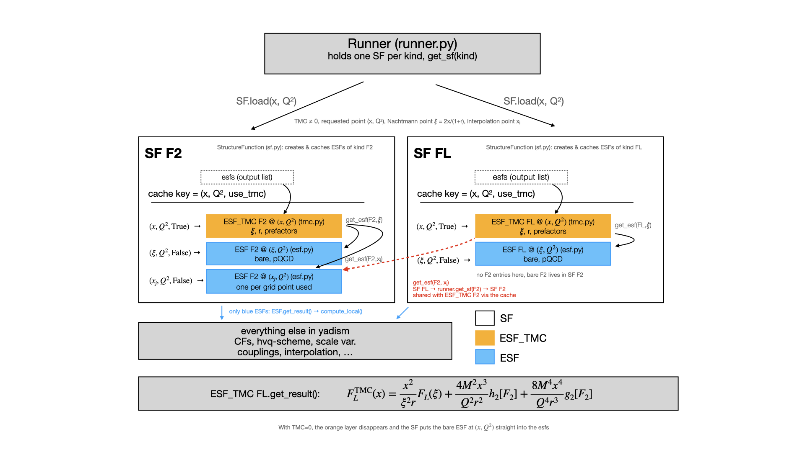

Target Mass Corrections
=======================

The master equation for DIS,
:math:`\sigma(x,Q^2) = \sum_j\int_x^1 \frac{dz}{z}C_j(z,Q^2)f_j(\xi=x/z,Q^2)+\mathcal{O}\left(\frac{\Lambda^2_{\mathrm{QCD}}}{Q^2}\right)`
can be evaluated in pertubative QCD (pQCD) in the collinear factorization scheme.

However, we observe that there are non-perturbative corrections,
which elicits the concept of leading and higher twist. These higher twist contributions are summarized as
:math:`\mathcal{O}\left(\frac{\Lambda^2_{\mathrm{QCD}}}{Q^2}\right)`.
An important distinction to make, is that the PDFs themselves are well-defined, renormalized,
gauge-invariant, and non-perturbative quantities. The notion that they are
leading-twist objects only comes in where they enter the power expansion of a hard-scattering observable.

These corrections :math:`\mathcal{O}\left(\frac{\Lambda^2_{\mathrm{QCD}}}{Q^2}\right)` are complex and
contain many non-perturbative matrix elements and depend on multiparton correlations. Indeed,
properly separating the leading-twist terms from higher-twist terms correlations is difficult and
unstable.

A part of these higher-twist terms however, so called target mass corrections (TMCs), are
calculable systematically and consistently. These are required in order to correct for
effects relating to the non-zero mass of the target. Target-mass corrections account
for these effects, which arise from the trace of the twist-2 operators in the OPE.
Since the TMCs are not dependent on the perturbative order, they are a kinematic correction that applies to every order.
In particular, this has an effect in the large-:math:`x`, small-:math:`Q^2` region.

.. note::

   YADISM only computes the TMCs, i.e. the kinematic, twist-2 part of the power
   corrections. Actual higher-twist contributions are not
   computed: they depend on unknown multiparton matrix elements and are
   usually either cut away (see :ref:`below <tmc-w2-cut>`) or parametrized and
   fitted together with the PDFs. For recent examples of the latter see
   :cite:`Ball:2025xgq`, where higher-twist corrections are included in a global
   fit as a theory uncertainty in the theory covariance matrix, and
   :cite:`Cerutti:2025yji` for the large-:math:`x` systematics associated to
   different higher-twist parametrizations.

.. _tmc-w2-cut:

The :math:`W^2` cut
-------------------
In DIS, among :doc:`other kinematic quantities <../theory/intro>`, we can define
:math:`W^2 = (P+q)^2 = M^2 + 2P\cdot q + q^2`
with
:math:`Q^2 = -q^2, \, \, \, \, x = \frac{Q^2}{2P \cdot q},`
so that
:math:`W^2 = M^2 + Q^2\left( \frac{1}{x} - 1\right).`
This quantity :math:`W^2` is defined as the invariant mass squared of the hadronic system,
produced when a virtual boson interacts with the targeted nucleon.
It is just as important as :math:`Q^2` in DIS: :math:`Q^2` sets the scale of the interaction,
and :math:`W^2` sets the energy available to the final state. At fixed :math:`Q^2`,
large :math:`x` means small :math:`W^2` and vice versa, so the high-:math:`x` region
is exactly where the final state is low-mass and TMCs gain in effect.

A scattering is inelastic when the nucleon breaks up, i.e. when :math:`W^2 > M^2`.
On the other hand, in the elastic limit of :math:`x=1`, the nucleon stays fully intact,
and the scattering is elastic. For the proton, :math:`M \simeq 0.938` GeV, so
:math:`W^2 \simeq 1.5 \mathrm{GeV}^2`. A process only counts as deep-inelastic when
:math:`Q^2` is large enough for pQCD to apply, and :math:`W^2` is large enough
to be above the resonance region.
In the Bjorken limit, where
:math:`Q^2 \gg M^2,` we can in principle neglect terms proportional to the
expansion parameter :math:`M^2/Q^2`.
For a nucleon of finite mass and at low :math:`Q^2`, however, this expansion
parameter grows and becomes non-negligible, so TMCs become non-negligible.
Therefore, :math:`W^2` is an effective measure to define the region in which TMCs,
among other resonance effects, become large. Placing a cut on :math:`W^2`
restricts the accesible :math:`x` range at a given :math:`Q^2` and allows us to exclude
the region in which TMCs become important.
In ``NNPDF`` fits, typical values are :math:`W^2_{\mathrm{cut}} > 12.5 \mathrm{GeV}^2` and
:math:`Q^2_{\mathrm{cut}} > 3.49 \mathrm{GeV}^2` to err on the safe side: TMCs are included,
and cuts are placed to ensure the scattering is deep-inelastic and we are above the resonance limit.
The same cuts are the main handle against the (non-calculable) dynamical higher-twist
terms, unless these are explicitly modelled as in :cite:`Ball:2025xgq`.

Kinematics
----------

In practice, TMCs amount to a shift in kinematics and a reweighting.
We define the Nachtmann variable, with which we rescale :math:`x`:
:math:`\xi_N = \frac{2x}{1+r},`
with
:math:`r = \sqrt{1+\frac{4x^2M^2}{Q^2}}.`
One notices that in the case where :math:`M\rightarrow 0` and :math:`\xi_N \rightarrow x`,
the TMCs disappear.

The structure functions can therefore be expressed in terms of the bare (noTMC) structure functions,
evaluated at the rescaled Nachtmann variable, for example in the case of :math:`F_2` as follows :cite:`Schienbein:2007gr`:

.. math::

   F_2^{\mathrm{TMC}}(x,Q^2) = \frac{x^2}{\xi^2_Nr^3}F_2^{\mathrm{noTMC}}(\xi_N,Q^2)
      + \frac{6M^2x^3}{Q^2r^4}h_2(\xi_N,Q^2)
      + \frac{12M^4x^4}{Q^4r^5}g_2(\xi_N,Q^2)

with

.. math::

   h_2(\xi_N,Q^2) &= \int_{\xi_N}^1 du\, \frac{F_2^{\mathrm{noTMC}}(u,Q^2)}{u^2}
                  = \left(\frac{z}{\xi_N} \otimes F_2^{\mathrm{noTMC}}(Q^2)\right)(\xi_N) \\
   g_2(\xi_N,Q^2) &= \int_{\xi_N}^1 du\, (u-\xi_N)\frac{F_2^{\mathrm{noTMC}}(u,Q^2)}{u^2}
                  = \left((1-z) \otimes F_2^{\mathrm{noTMC}}(Q^2)\right)(\xi_N).

The longitudinal structure functions
""""""""""""""""""""""""""""""""""""

:math:`F_L` needs to be mentioned separately, because its target-mass-corrected
version is not only a function of the bare :math:`F_L`: it also contains terms
proportional to the bare :math:`F_2`
(through the same :math:`h_2` and :math:`g_2` integrals as above). Following
:cite:`Schienbein:2007gr` (see also :cite:`Goharipour:2020gsw`):

.. math::

   F_L^{\mathrm{TMC}}(x,Q^2) = \frac{x^2}{\xi^2_N r}F_L^{\mathrm{noTMC}}(\xi_N,Q^2)
      + \frac{4M^2x^3}{Q^2r^2}h_2(\xi_N,Q^2)
      + \frac{8M^4x^4}{Q^4r^3}g_2(\xi_N,Q^2).

We see that :math:`F_L^{\mathrm{TMC}}` is non-zero even when the bare
:math:`F_L` vanishes (e.g. in the parton model at LO), and computing
:math:`F_L` with TMCs always requires the bare :math:`F_2`
as well (see the diagram in :ref:`tmc-diagram`).

Similar equations exist for :math:`F_1` and :math:`F_3`, which have been
implemented in YADISM, see :mod:`yadism.esf.tmc`.

Approximate formulas
""""""""""""""""""""

One notices that the equations above are convolutions, so a simple evaluation has been turned
into a convolution. Given that we precompute the structure functions on an interpolation grid,
these more complex objects need to be folded into the precomputed objects, increasing the size of the output
and slowing down the calculation. YADISM therefore implemented an approximation that reduces things back
to a simple evaluation :cite:`Schienbein:2007gr,Goharipour:2020gsw`,

.. math::

   F_2^{\mathrm{TMC}}(x,Q^2) \approx \frac{x^2}{\xi^2_Nr^3}F_2^{\mathrm{noTMC}}(\xi_N,Q^2)
      \left(1+\frac{6M^2x\xi_N}{Q^2r}(1-\xi_N)^2\right)

and analogously for :math:`F_L`, where again the bare :math:`F_2` appears:

.. math::

   F_L^{\mathrm{TMC}}(x,Q^2) \approx \frac{x^2}{\xi^2_N r}\left[
      F_L^{\mathrm{noTMC}}(\xi_N,Q^2)
      + \left(\frac{4M^2x\xi_N}{Q^2r}(1-\xi_N)
      + 8\left(\frac{M^2x\xi_N}{Q^2r}\right)^2\left(-\ln\xi_N - 1 + \xi_N\right)\right)
      F_2^{\mathrm{noTMC}}(\xi_N,Q^2)\right].

Nuclear targets
"""""""""""""""

The formulas above are derived in the OPE for a nucleon target, so one may wonder
whether they need to be modified for a nuclear target, where the natural mass
scale is :math:`M_A \approx A\,M` rather than :math:`M`. This has been studied
in detail in :cite:`Ruiz:2023ize`, which shows that the nucleon OPE results carry over to nuclei when
written in terms of per-nucleon (rescaled) kinematic variables, so that the
corrections become approximately independent of the nuclear target.
The upshot for YADISM (see `issue #252 <https://github.com/NNPDF/yadism/issues/252>`_) 
is that nothing changes: the
implementation applies to nuclear targets as is, with
structure functions per nucleon and the nucleon mass as target mass.

Polarized structure functions
"""""""""""""""""""""""""""""

TMCs are also available for the polarized structure function :math:`g_1`
(:class:`~yadism.esf.tmc.ESFTMC_g1`), see :cite:`Accardi:2008pc` and
:cite:`Khanpour:2017cha`. The implementation of polarized DIS in YADISM, including
the heavy-quark (FONLL) treatment is described in detail in :cite:`Hekhorn:2024jdh`.

In YADISM
---------

One can enable TMCs with the ``TMC`` flag in the input runcard, with multiple options:

- **TMC: 0 (Disabled)**:
  No target mass corrections are applied and the SFs are evaluated at :math:`(x,Q^2)`.
- **TMC: 1 (APFEL)**:
  The ``APFEL`` formalism is used (see :cite:`nnpdf-1.0`). This is the expression
  above with the :math:`g_2` term dropped, i.e. only the shifted
  structure function and the :math:`h_2` convolution are kept.
- **TMC: 2 (Approx)**:
  The approximation mentioned above is used to speed up the calculation. The
  convolutions are replaced by a simple evaluation of the bare structure
  function at :math:`\xi_N`, so no convolution is required.
- **TMC: 3 (Exact)**:
  The full expression above is used, including both the :math:`h_2` and the
  :math:`g_2` convolutions.

.. _tmc-diagram:

Implementation
--------------

Similar to how the TMC corrected structure functions are defined on top of the bare ones, the
structures in the code form an intermediate block between the class :class:`~yadism.sf.StructureFunction`
and the actual calculator :class:`~yadism.esf.esf.EvaluatedStructureFunction` - in a sense they are the replacement for the latter.

:class:`~yadism.sf.StructureFunction` is the manager. It holds a reference to its parent runner,
such that it is also able to access its :class:`~yadism.sf.StructureFunction` siblings (``FL_TMC`` also
requires terms built from the bare ``F2``). It instantiates
:class:`~yadism.esf.tmc.EvaluatedStructureFunctionTMC` according to the ``TMC`` flag, as opposed to
its TMC-less sibling :class:`~yadism.esf.esf.EvaluatedStructureFunction`.

The hierarchy is shown in the following diagram:

   Each ``SF`` holds both its ESF_TMC (orange) and the bare ESFs (blue) in its
   cache. The ESF_TMC only requests bare ESFs through ``SF.get_esf``, and only
   the bare ESFs reach the rest of yadism.

A bare ESF is computed only the first time it is requested; later requests are
cache look-ups. With ``TMC = 0`` the ESF_TMC layer is skipped and the SF creates
the bare ESF at :math:`(x, Q^2)` directly.

Reading the diagram top to bottom:

1. The **Runner** asks every :class:`~yadism.sf.StructureFunction` (``SF``) to
   load the requested kinematics.
2. The ``SF`` creates, for each requested point, an ``ESFTMC`` (if ``TMC != 0``)
   or a plain ``ESF`` (if ``TMC == 0``). This object is what ends up in
   ``SF.esfs`` and is returned to the user, always at the requested
   :math:`(x, Q^2)`.
3. The ``ESFTMC`` does no perturbative computation itself, it only asks the ``SF``
   for *bare* ESFs (``use_raw=True``) at the shifted point :math:`(\xi_N, Q^2)`
   and, for the :math:`h_2`/:math:`g_2` convolutions, at the grid points
   :math:`(x_j, Q^2)`. Requests for a different kind are forwarded to the sibling ``SF`` through the runner.
4. The bare **ESF** objects contract coefficient functions with the
   interpolation basis; this is the expensive step, and the reason for caching.

Caching
-------
A TMC-corrected structure function is built from bare structure functions at other points. Computing
a bare strucure function is expensive, and the same bare value is often needed many times:

- :math:`F_2^{\mathrm{TMC}}(x, Q^2)` needs the bare :math:`F_2` at the shifted point :math:`(\xi_N, Q^2)`.
- In the APFEL and exact modes, it also needs the convolutions :math:`h_2` and
  :math:`g_2`. These need the bare :math:`F_2` at each interpolation-grid point
  :math:`x_j` (at the same :math:`Q^2`).
- Different requested points with the same :math:`Q^2` need the same grid points.
  Also, :math:`F_L^{\mathrm{TMC}}` needs the bare :math:`F_2` in addition to the bare :math:`F_L`.

We need to cache these values, because each of these quantities would be recomputed every time,
which is redundant because we know they use the same (global) interpolation points.

Caching is managed at the level of :class:`~yadism.sf.StructureFunction` (``SF``), while the values are
kept at the level of ``ESF``, so the ``SF`` is just routing the caller to the correct instance of
``ESF`` to ask for values:

- The ``SF`` instantiates an ``ESFTMC``, and for each one it calls ``SF.get_esf(kind, kinematics)`` on its parent ``SF``.
  It appends this to ``self.esfs`` at load time, i.e. in ``self.load()`` (these are the observables to be computed).
  For ``F_L`` or ``F_3`` corrections it can ask for a different kind, which it reaches through the parent ``runner``.
- The ``SF`` checks whether an ``ESF`` already exists. If yes, it returns it without recomputing, and if no, it is
  created, registered in the cache, and returned. The cache key is :math:`(x, Q^2, \texttt{use\_tmc})`,
  so the TMC-corrected object at a point and the bare object at the same point never collide
  (see the cache keys in the diagram above).

References
----------
- Review of TMCs and the formulae used here: :cite:`Schienbein:2007gr`, :cite:`Goharipour:2020gsw`, :cite:`tmc-georgi`
- Nuclear targets: :cite:`Ruiz:2023ize`
- Polarized structure functions: :cite:`Accardi:2008pc`, :cite:`Khanpour:2017cha`, :cite:`Hekhorn:2024jdh`
- Dynamical higher twist in PDF fits: :cite:`Ball:2025xgq`, :cite:`Cerutti:2025yji`, :cite:`Owens:2012bv`
